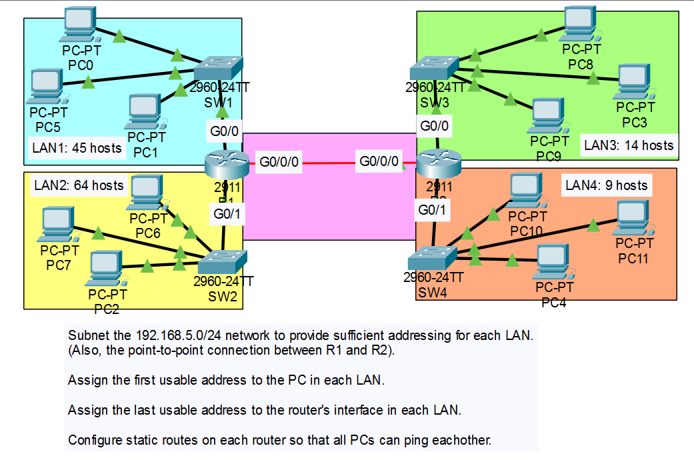
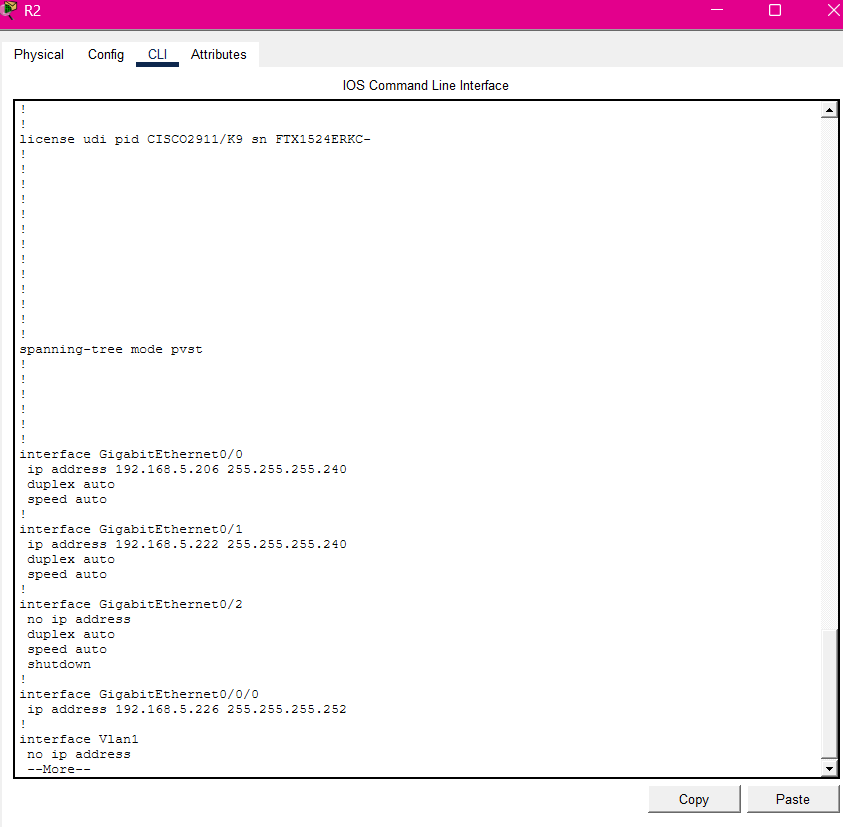
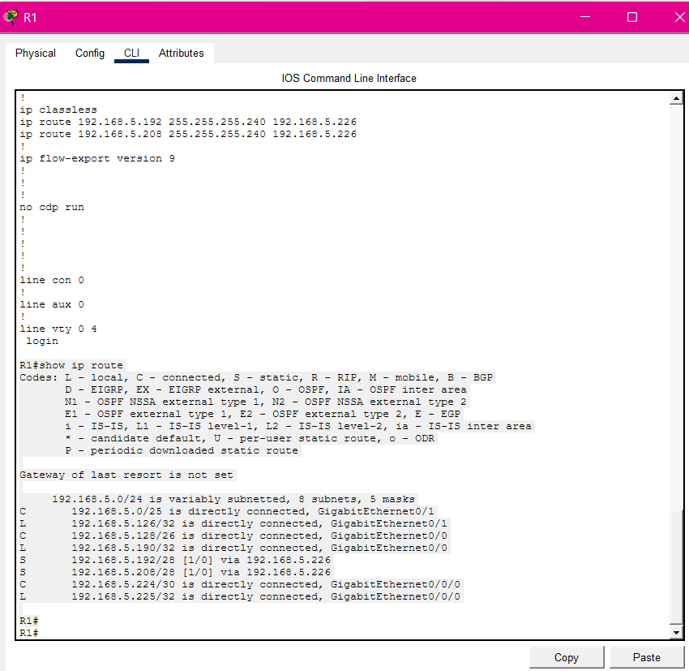
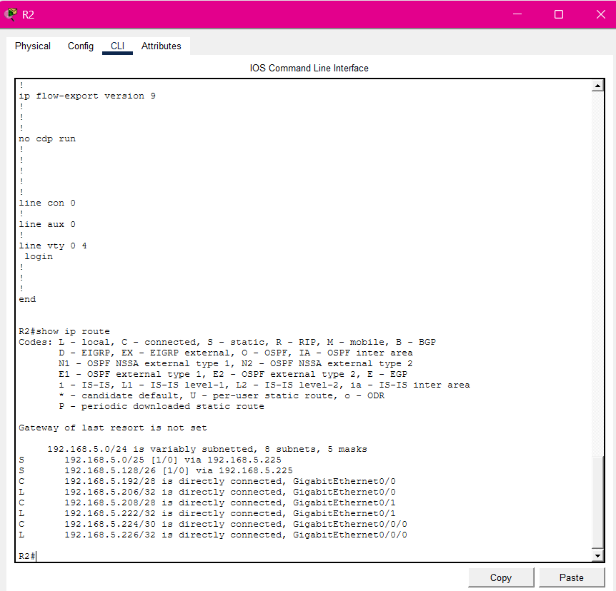
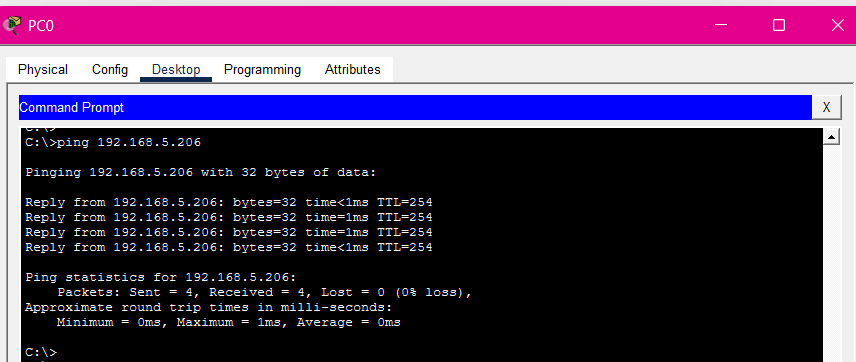

# Two-Router Static Routing Using Cisco Packet Tracer

A practical network infrastructure project designed and implemented using Cisco Packet Tracer.

This project demonstrates IPv4 subnetting, network configuration, static routing, and end-to-end connectivity between four LAN segments connected through two routers.

## Network Topology

## Project Overview

The network consists of:
- 2 Cisco 2911 routers (R1 and R2)
- 4 LAN segments
- 4 Cisco 2960 switches
- Multiple end devices (PCs)
- 1 point-to-point connection between routers

## Network Configuration

The project uses the `192.168.5.0/24` network, which is subnetted to accommodate the four LAN segments and the point-to-point router connection.

Key configurations:
- IPv4 addressing and subnetting
- Router interface configuration
- Static routing between routers
- Default gateway configuration on PCs
- End-to-end connectivity testing

## Configuration Screenshots

### Router Interface Configuration

### Routing Tables

**Router1**

**Router2**

## Connectivity Testing

The following screenshot demonstrates successful connectivity testing from PC0 to another network device.

## Project Files

| File | Description |
|---|---|
| `two-router-static-routing-topology.pkt` | Cisco Packet Tracer project |
| `network-topology.png` | Network topology diagram |
| `router1-routing-table.png` | Router1 routing table |
| `router2-routing-table.png` | Router2 routing table |
| `router2-interface-config.png` | Router2 interface configuration |
| `pc0-ping-test.png` | PC0 connectivity test |

## Tools & Technologies

- Cisco Packet Tracer
- Cisco IOS CLI
- IPv4 Subnetting
- Static Routing

## Author

**Agnes Siagian**  
Institut Teknologi DEL
